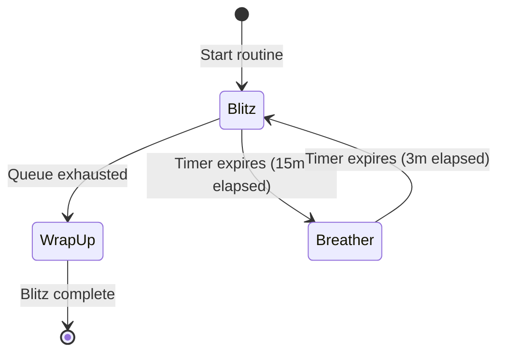
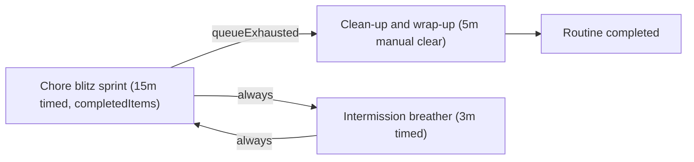

# Chore blitz execution

The chore blitz routine executes household tasks or quick work items against a fixed countdown duration.
Users complete queue items rapidly with immediate check-off interactions.
When the task queue empties before the countdown lapses, the routine advances early to a wrap-up phase.
Upon phase completion, Routine Flow executes batch frontmatter write-backs across all completed items.

## Workflow overview

Standard pomodoro intervals track work against a single active task.
A chore blitz operates differently by cycling through many small tasks within a single timed block:

1. **Timed blitz sprint**: A fixed countdown timer (such as 15 minutes) begins with a bound task queue.
2. **Rapid check-off**: Clicking the Done button immediately marks the active task completed, updates the live completed counter, and activates the next candidate note.
3. **Early exhaustion exit**: If all queue items are completed before the countdown ends, the engine advances early to wrap-up.
4. **Batch write-back**: The engine resolves all items completed during the blitz phase and batch-updates frontmatter metadata in your vault notes.
5. **Recovery breather**: If the countdown lapses while tasks remain, the routine transitions to an intermission breather before starting the next sprint.

## State machine topology

The chore blitz state graph provides two paths out of the blitz phase:





## Routine configuration

The routine definition uses `condition: { kind: 'queueExhausted' }` and `logTarget: { kind: 'completedItems' }`:

```markdown
---
is-routine: true
---

# Chore blitz routine

Hand-authored routine file with queueExhausted terminal branch and completedItems batch write-back.

```json
{
  "id": "chore-blitz",
  "name": "Chore blitz",
  "phases": [
    {
      "id": "blitz",
      "label": "Chore blitz sprint",
      "kind": "focus",
      "duration": "PT15M",
      "taskSourceId": "chore-queue",
      "completionPolicy": null,
      "notification": null,
      "logTarget": {
        "kind": "completedItems"
      },
      "actions": [
        {
          "id": "done",
          "label": "Done",
          "style": "primary",
          "payload": {
            "kind": "markDone"
          }
        }
      ],
      "onEnter": null,
      "onComplete": "write-back",
      "onSkip": null,
      "onExit": null
    },
    {
      "id": "breather",
      "label": "Intermission breather",
      "kind": "break",
      "duration": "PT3M",
      "taskSourceId": null,
      "completionPolicy": null,
      "notification": null,
      "logTarget": {
        "kind": "activeItem"
      },
      "actions": [],
      "onEnter": null,
      "onComplete": null,
      "onSkip": null,
      "onExit": null
    },
    {
      "id": "wrap-up",
      "label": "Clean-up and wrap-up",
      "kind": "ritual",
      "duration": "PT5M",
      "taskSourceId": null,
      "completionPolicy": {
        "kind": "manualClear"
      },
      "notification": null,
      "logTarget": {
        "kind": "activeItem"
      },
      "actions": [],
      "onEnter": null,
      "onComplete": null,
      "onSkip": null,
      "onExit": null
    }
  ],
  "transitions": [
    {
      "fromPhaseId": "blitz",
      "toPhaseId": "wrap-up",
      "condition": {
        "kind": "queueExhausted"
      }
    },
    {
      "fromPhaseId": "blitz",
      "toPhaseId": "breather",
      "condition": {
        "kind": "always"
      }
    },
    {
      "fromPhaseId": "breather",
      "toPhaseId": "blitz",
      "condition": {
        "kind": "always"
      }
    }
  ]
}
```
```

## Key mechanisms

### Rapid task check-off and dynamic counter

During a blitz sprint, users require immediate UI response without waiting for file writes or query re-indexing.
When a user clicks the Done action button:
1. The queue item Done action immediately dispatches `record-item-completion`.
2. Selection advances immediately to the next remaining chore in the queue.
3. The queue panel header increments the live completed chore badge.
4. File mutations execute asynchronously in the background.

### Early phase termination on queue exhaustion

When all queue items are cleared, waiting for the timer countdown to expire wastes time.
The engine reducer evaluates outgoing transitions when queue exhaustion occurs.
If an outgoing transition specifies `condition: { kind: 'queueExhausted' }`, the engine advances immediately to the target phase.
The completed phase instance records `endReason: 'completed'` in session history.
If no `queueExhausted` edge exists, normal timer countdown continues uninterrupted.

### Batch frontmatter write-backs

Phases configured with `logTarget: { kind: 'completedItems' }` track all completed tasks during the phase instance.
When the phase concludes, the write-back hook resolves every unique note path from `itemsTouched` marked with `status: 'completed'`.
The hook reads current frontmatter values and generates batch mutations to increment `sessions` across all completed chore notes.
If the queue emptied and `activeFilePath` is null, the write-back hook still resolves completed items from the phase instance history.
