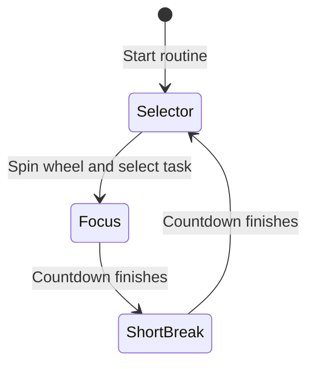
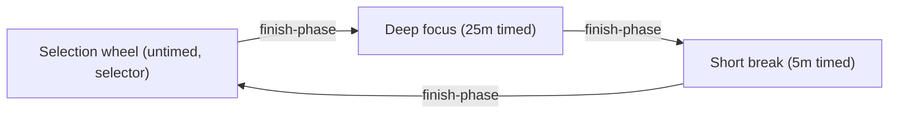

# Random task selector routine

The random task selector routine selects and promotes tasks with a roulette wheel animation before starting timed focus and break intervals.
By automating task selection with randomized roulette sampling, the routine eliminates decision fatigue and prioritizes work from your Obsidian Bases queue.

## Workflow overview

When a task queue contains multiple pending items of equal priority, choosing the next task can cause delay.
The random task selector pattern addresses this friction:

1. **Selection wheel**: The routine queries matching tasks from Obsidian Bases and shows them in the queue panel.
2. **Roulette deceleration**: Clicking the spin control triggers a deceleration schedule that rapidly steps through candidates before landing on a winner.
3. **Task promotion**: The winner task promotes to the top of the queue and becomes the active file for session notes.
4. **Focus interval**: The user starts deep focus on the selected task note.
5. **Break interval**: A timed break interval follows each focus block before cycling back to the selector.

## State machine topology

The routine follows a three-stage cycle:





## Routine configuration

The routine definition file uses the `selector` phase kind with queue filter and promotion options:

```markdown
---
is-routine: true
---

# Random task selector routine

```json
{
  "id": "random-selector",
  "name": "Random task selector",
  "phases": [
    {
      "id": "selector",
      "name": "Spin task wheel",
      "label": "Spin task wheel",
      "kind": "selector",
      "duration": null,
      "onCompletion": "waitForManual",
      "taskSourceId": "selector-queue",
      "queryFilter": {
        "property": "note.type",
        "value": "random-selector-task"
      },
      "selector": {
        "autoSpin": false,
        "promoteToFront": true
      },
      "handlers": {}
    },
    {
      "id": "focus",
      "name": "Focus sprint",
      "label": "Focus sprint",
      "kind": "focus",
      "duration": "PT25M",
      "onCompletion": "autoAdvance",
      "taskSourceId": "selector-queue",
      "queryFilter": {
        "property": "note.type",
        "value": "random-selector-task"
      },
      "handlers": {}
    },
    {
      "id": "short-break",
      "name": "Short break",
      "label": "Short break",
      "kind": "break",
      "duration": "PT5M",
      "onCompletion": "autoAdvance",
      "handlers": {}
    }
  ],
  "transitions": [
    {
      "from": "selector",
      "to": "focus",
      "guard": {
        "kind": "always"
      }
    },
    {
      "from": "focus",
      "to": "short-break",
      "guard": {
        "kind": "always"
      }
    },
    {
      "from": "short-break",
      "to": "selector",
      "guard": {
        "kind": "always"
      }
    }
  ]
}
```
```

## Bases view setup

Add a routine timer view to your `.base` configuration file:

```yaml
views:
  - type: routine-timer
    name: Random task selector
    routineFile: random-selector/random-selector-routine.md
```

Each candidate task note sets the target frontmatter tag:

```markdown
---
type: "random-selector-task"
priority: 20
due: 2026-01-01
status: "todo"
---
```

## Usage notes

### Selection roulette and deceleration

The spin animation cycles through queue items using an exponential deceleration schedule.
The spin button disables while the animation runs to prevent concurrent dispatches.
When deceleration completes, the winner item receives a persistent visual highlight.

### Task promotion and active file binding

When `promoteToFront: true` is configured on the selector phase, picking a winner reorders the queue.
The winning item moves to index 0 and sets `activeFilePath` in the engine store.
Downstream phases then target this file for session tracking and note write-backs.

### Accessibility and reduced motion

The selector honors the operating system `prefers-reduced-motion` media setting.
When reduced motion is enabled, the selector bypasses the deceleration timer steps and selects the winner immediately.
Screen readers receive accessibility announcements when winner selection concludes.

### Manual vs automatic spin

By default, `autoSpin: false` waits for the user to click the spin button in the queue panel.
Setting `autoSpin: true` automatically triggers the roulette roll when the routine enters the selector phase.
An untimed `duration: null` allows the user to review the selected task before advancing to the focus sprint.
