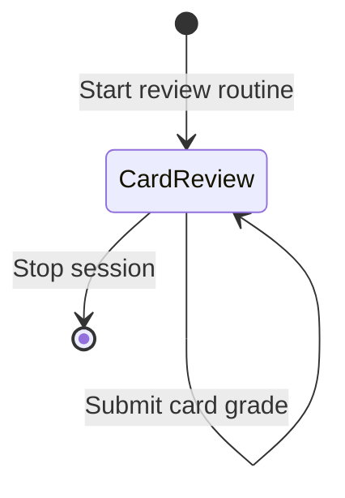
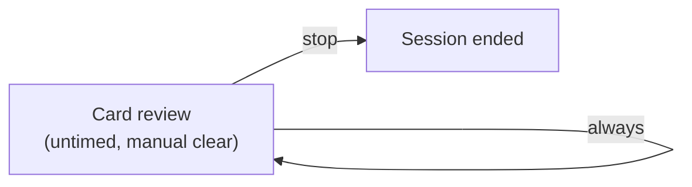

# Spaced repetition and Leitner box

The Leitner box routine organizes flashcard notes into spaced repetition review queues.
Users review flashcard notes at increasing time intervals based on recall performance.
When a user reviews a card and selects a grade action, Routine Flow updates the card frontmatter, calculates the next review due date, and advances the queue.
Deferred cards disappear from the active review queue until their due date arrives.

## Workflow overview

The Leitner box method improves learning retention by scheduling flashcard reviews at expanding intervals:

1. **Card selection**: The timer view loads flashcard notes that are due today or overdue from Obsidian Bases.
2. **Recall review**: The user inspects the active flashcard prompt note and recalls the target concept.
3. **Grade response**: The user selects one of four review actions on the active card:
   - **Again (10m)**: Demotes the card to Box 1 and defers review by 10 minutes (`PT10M`).
   - **Hard (1d)**: Places the card into Box 2 and defers review by 1 day (`P1D`).
   - **Good (3d)**: Promotes the card to Box 3 and defers review by 3 days (`P3D`).
   - **Easy (7d)**: Promotes the card to Box 4 and defers review by 7 days (`P7D`).
4. **Frontmatter mutation**: Routine Flow writes the updated box tier, sets `routine-status: "deferred"`, and writes the calculated timestamp into `routine-due`.
5. **Queue advancement**: The reviewed card disappears from the queue view, and the view activates the next due card.

## State machine topology

The Leitner box routine uses an untimed review phase that loops indefinitely:





## Routine configuration

The routine definition specifies the `review-queue` task source, the `queryFilter` constraint, and declarative review action buttons:

```markdown
---
is-routine: true
---

# Leitner box spaced review

```json
{
  "id": "leitner-box",
  "name": "Leitner box spaced review",
  "phases": [
    {
      "id": "review",
      "label": "Card review",
      "kind": "review",
      "duration": null,
      "taskSourceId": "review-queue",
      "queryFilter": {
        "property": "note.type",
        "value": "flashcard"
      },
      "completionPolicy": {
        "kind": "manualClear"
      },
      "logTarget": {
        "kind": "activeItem"
      },
      "actions": [
        {
          "id": "grade-again",
          "label": "Again (10m)",
          "style": "destructive",
          "payload": {
            "kind": "deferDuration",
            "after": "PT10M",
            "property": "routine-due",
            "box": 1
          }
        },
        {
          "id": "grade-hard",
          "label": "Hard (1d)",
          "payload": {
            "kind": "deferDuration",
            "after": "P1D",
            "property": "routine-due",
            "box": 2
          }
        },
        {
          "id": "grade-good",
          "label": "Good (3d)",
          "style": "primary",
          "payload": {
            "kind": "deferDuration",
            "after": "P3D",
            "property": "routine-due",
            "box": 3
          }
        },
        {
          "id": "grade-easy",
          "label": "Easy (7d)",
          "payload": {
            "kind": "deferDuration",
            "after": "P7D",
            "property": "routine-due",
            "box": 4
          }
        }
      ]
    }
  ],
  "transitions": [
    {
      "fromPhaseId": "review",
      "toPhaseId": "review",
      "condition": {
        "kind": "always"
      }
    }
  ]
}
```
```

## Frontmatter schema

Each flashcard note tracks its review status, current box tier, and due date in YAML frontmatter:

```markdown
---
type: "flashcard"
box: 1
routine-status: "pending"
routine-due: 2026-10-31
---

# Binary search complexity

What is the worst-case time complexity of binary search on a sorted array of size $N$?

**Answer**: $O(\log N)$
```

The property fields serve distinct purposes:

- **`type`**: Identifies the note as a flashcard for Bases query filters.
- **`box`**: Tracks the Leitner box interval level (1 through 4).
- **`routine-status`**: Distinguishes ready notes (`pending`) from deferred notes (`deferred`).
- **`routine-due`**: Stores the ISO date when the card becomes due for review.

## Obsidian Bases query configuration

Obsidian Bases queries filter cards based on the due date and card type.
Configure the `.base` file with a routine timer view and filter rules:

```yaml
type: base
properties:
  note.box:
    displayName: Box
  note.routine-due:
    displayName: Due date
  note.routine-status:
    displayName: Routine status
  note.type:
    displayName: Type
views:
  - type: routine-timer
    name: Leitner box review
    routineFile: leitner-box/leitner-box-routine.md
    focusProperty: note.type
    focusValue: flashcard
    filters:
      and:
        - note.routine-due <= today
  - type: table
    name: Due review cards
    filters:
      and:
        - note.routine-due <= today
```

The `note.routine-due <= today` filter excludes cards that are deferred into future dates.
When a user clicks a grade action such as `Good (3d)`, Routine Flow writes a future date to `routine-due`.
The queue source evaluates the date against the current time, removes the deferred card, and displays the next available card in the sequence.
