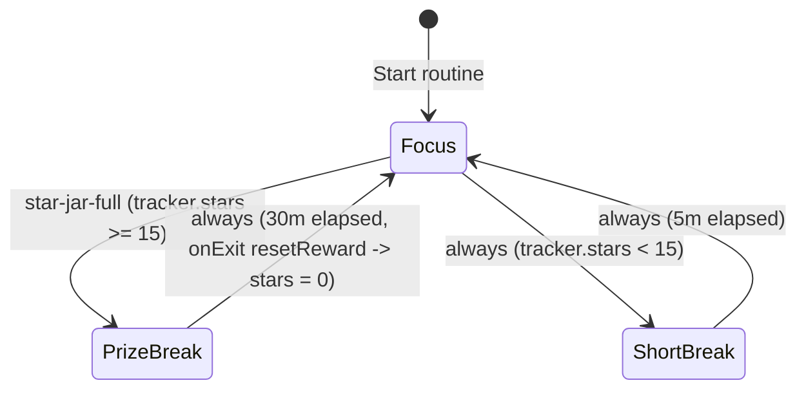
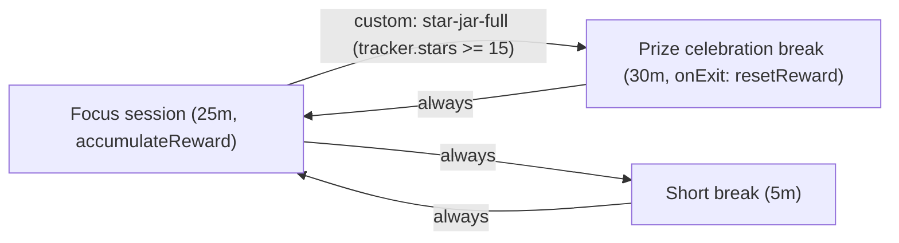

# Star jar token economy

The star jar reward routine implements a stateful token economy in Obsidian.
Completing sized tasks during focus intervals accumulates star points into a dedicated vault tracker note (`Star-Jar-Tracker.md`).
When the accumulated balance reaches the 15-star milestone (`tracker.stars >= 15`), a custom transition guard branches the routine into a 30-minute prize celebration break and resets the star bank upon exit.

## Workflow overview

Unlike simple cycle counters (`everyNth`) that treat every focus block identically, a token economy weights each completed task by its effort size:

1. **Variable task sizing**: Tasks in `star-jar-economy/` declare a `stars` weight (`1`, `2`, `3`, or `5`) in YAML frontmatter and display a star badge in the queue panel.
2. **Reward bank accumulation**: When a `focus` session completes, the `accumulateReward` preset handler reads the active task's `stars` value and adds it to the `stars` property in `star-jar-economy/Star-Jar-Tracker.md`.
3. **Threshold guard evaluation**: Before advancing from `focus`, the engine synchronously reads `trackerFrontmatter` from `Star-Jar-Tracker.md` and evaluates the custom predicate `star-jar-full` (`tracker.stars >= 15`).
4. **Standard vs. milestone break**: If `tracker.stars < 15`, the routine takes the fallback `always` transition to a 5-minute `short-break`. Once `tracker.stars >= 15`, the guarded transition routes to the 30-minute `prize-break`.
5. **Bank reset on exit**: Exiting `prize-break` triggers the `resetReward` preset handler on `onExit`, resetting `stars: 0` in `Star-Jar-Tracker.md` for the next reward cycle.

## State machine topology

The star jar state machine evaluates the `star-jar-full` (`tracker.stars >= 15`) guard first when leaving the focus session:





## Routine configuration

The routine definition in `star-jar-economy/star-jar-routine.md` binds `trackerFilePath` at the graph level and wires the `accumulateReward` and `resetReward` preset handlers:

```markdown
---
is-routine: true
---

# Star jar reward routine

Stateful token economy routine that accumulates task stars into a tracker note and branches to a prize celebration break at 15 stars.

```json
{
  "id": "star-jar",
  "name": "Star jar reward routine",
  "trackerFilePath": "star-jar-economy/Star-Jar-Tracker.md",
  "phases": [
    {
      "id": "focus",
      "label": "Focus session",
      "kind": "focus",
      "duration": "PT25M",
      "taskSourceId": "star-tasks",
      "logTarget": {
        "kind": "activeItem"
      },
      "badges": [
        {
          "property": "stars",
          "label": "Stars",
          "icon": "star",
          "variant": "accent"
        }
      ],
      "handlers": {
        "onComplete": [
          {
            "kind": "preset",
            "preset": "accumulateReward"
          }
        ]
      },
      "onCompletion": "waitForManual"
    },
    {
      "id": "short-break",
      "label": "Short break",
      "kind": "break",
      "duration": "PT5M",
      "onCompletion": "autoAdvance"
    },
    {
      "id": "prize-break",
      "label": "Prize celebration break",
      "kind": "break",
      "duration": "PT30M",
      "onCompletion": "autoAdvance",
      "handlers": {
        "onExit": [
          {
            "kind": "preset",
            "preset": "resetReward"
          }
        ]
      }
    }
  ],
  "transitions": [
    {
      "from": "focus",
      "to": "prize-break",
      "guard": {
        "kind": "custom",
        "predicate": "star-jar-full"
      }
    },
    {
      "from": "focus",
      "to": "short-break",
      "guard": {
        "kind": "always"
      }
    },
    {
      "from": "short-break",
      "to": "focus",
      "guard": {
        "kind": "always"
      }
    },
    {
      "from": "prize-break",
      "to": "focus",
      "guard": {
        "kind": "always"
      }
    }
  ]
}
```
```

## Key mechanisms

### Point bank tracker note (`Star-Jar-Tracker.md`)

The routine stores its persistent reward balance in `star-jar-economy/Star-Jar-Tracker.md`:

```markdown
---
stars: 0
target: 15
---

# Star jar point bank

Current accumulated stars toward reward milestone.
```

Because the balance lives in standard YAML frontmatter, it persists across Obsidian restarts and can be queried or displayed in Bases views alongside task notes.

### How `accumulateReward` updates `Star-Jar-Tracker.md`

When the `focus` phase completes, Routine Flow executes the `accumulateReward` preset handler configured in `handlers.onComplete`:

1. **Target resolution**: The handler resolves the tracker note path from `params.trackerFilePath` or the routine graph's top-level `trackerFilePath` (`star-jar-economy/Star-Jar-Tracker.md`).
2. **Task weight lookup**: It reads the `stars` property from the active task item (via projected `extraProperties.stars` from the queue source or directly from the active task note's frontmatter, defaulting to `1` if omitted).
3. **Frontmatter increment**: It reads the current numeric `stars` value from `Star-Jar-Tracker.md` (treating missing values as `0`) and emits a frontmatter mutation writing `currentStars + taskStars` back to `Star-Jar-Tracker.md`.

### Custom threshold predicate (`star-jar-full`)

To branch into `prize-break` when the jar reaches 15 stars, register the custom formula predicate `star-jar-full` in Routine Flow settings:

- **Name**: `star-jar-full`
- **Condition**: `tracker.stars >= 15`

Before evaluating phase transitions, `EngineStore` synchronously reads the frontmatter of `trackerFilePath` into `PredicateContext.trackerFrontmatter`, allowing the pure reducer to evaluate `tracker.stars >= 15` deterministically.

### How `resetReward` clears the bank on exiting `prize-break`

The `prize-break` phase attaches `{ "kind": "preset", "preset": "resetReward" }` to its `handlers.onExit` lifecycle hook.
When the 30-minute celebration break finishes (or when the user advances out of `prize-break` back to `focus`), `resetReward` emits a frontmatter mutation that writes `stars: 0` to `star-jar-economy/Star-Jar-Tracker.md`.
Placing `resetReward` on `onExit` rather than `onEnter` ensures the tracker displays the full milestone balance throughout the celebration break before resetting for the next cycle.

## Obsidian Bases setup

The example vault includes `Star-Jar.base` and `Star-Jar.md` to pair the timer with live task tables:

```yaml
type: base
properties:
  note.stars:
    displayName: Stars
  note.category:
    displayName: Category
  note.status:
    displayName: Status
  note.priority:
    displayName: Priority
  note.target:
    displayName: Milestone target
views:
  - type: routine-timer
    name: Star jar routine
    routineFile: star-jar-economy/star-jar-routine.md
    focusProperty: note.status
    focusValue: pending
    filters:
      and:
        - note.stars > 0
        - note.status == "pending"
  - type: table
    name: Active tasks
    filters:
      and:
        - note.stars > 0
        - note.status == "pending"
  - type: table
    name: Completed tasks
    filters:
      and:
        - note.stars > 0
        - note.status == "done"
```
