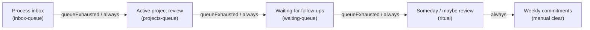
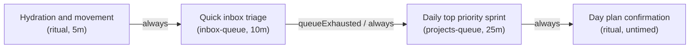
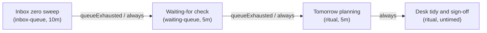

# Structured review cadences

Structured review cadences organize task reviews across daily and weekly workflows.
They guide users through sequential review stages, such as inbox triage, active project checks, and waiting-for follow-ups.
Each phase binds to specific task queries in Obsidian Bases, renders interactive checklist guidance, and advances automatically when queues empty.

## Workflow overview

Structured review cadences combine four key capabilities:

1. **Multi-query per-phase task switching**: Different phases in a single routine query different task sets using `taskSourceId` and `queryFilter`.
2. **Interactive stage guidance**: The timer view displays contextual checklist items defined in `phase.guidance` to assist execution.
3. **Queue exhaustion transitions**: When an inbox or review queue reaches zero items, transitions guarded by `queueExhausted` auto-advance to the next stage.
4. **Time and day cadence rules**: Routines map to schedule rules that activate the right cadence based on timestamp and day of week.

## Weekly GTD review

The weekly Getting Things Done (GTD) review routine processes incoming inputs, brings active projects current, and plans upcoming priorities.

### State machine topology



### Routine definition

The routine file configures distinct `queryFilter` criteria and checklist items for each review phase:

```json
{
  "id": "weekly-gtd",
  "name": "Weekly GTD review",
  "phases": [
    {
      "id": "inbox-clear",
      "label": "Process inbox to zero",
      "kind": "review",
      "duration": "PT15M",
      "taskSourceId": "inbox-queue",
      "queryFilter": {
        "property": "note.status",
        "value": "inbox"
      },
      "guidance": [
        "Process all loose physical papers and notes",
        "Triage email inboxes down to zero",
        "Clarify and convert inbox tasks to next actions"
      ]
    },
    {
      "id": "project-review",
      "label": "Active project review",
      "kind": "review",
      "duration": "PT20M",
      "taskSourceId": "projects-queue",
      "queryFilter": {
        "property": "note.status",
        "value": "active"
      },
      "guidance": [
        "Confirm every active project has at least one next action",
        "Archive completed projects",
        "Identify blocked project deliverables"
      ]
    },
    {
      "id": "waiting-review",
      "label": "Waiting-for follow-ups",
      "kind": "review",
      "duration": "PT10M",
      "taskSourceId": "waiting-queue",
      "queryFilter": {
        "property": "note.status",
        "value": "waiting"
      },
      "guidance": [
        "Follow up on overdue delegated items",
        "Record received updates",
        "Archive resolved waiting-for items"
      ]
    },
    {
      "id": "someday-maybe",
      "label": "Someday and maybe review",
      "kind": "ritual",
      "duration": "PT10M",
      "taskSourceId": null,
      "guidance": [
        "Review someday/maybe list for relevant project ideas",
        "Transfer viable ideas into active projects",
        "Discard obsolete interests"
      ]
    },
    {
      "id": "weekly-planning",
      "label": "Weekly commitments and focus",
      "kind": "ritual",
      "duration": null,
      "completionPolicy": {
        "kind": "manualClear"
      },
      "guidance": [
        "Choose 3 major outcome goals for the week",
        "Calendar deep focus time blocks",
        "Review personal and professional commitments"
      ]
    }
  ],
  "transitions": [
    { "fromPhaseId": "inbox-clear", "toPhaseId": "project-review", "condition": { "kind": "queueExhausted" } },
    { "fromPhaseId": "inbox-clear", "toPhaseId": "project-review", "condition": { "kind": "always" } },
    { "fromPhaseId": "project-review", "toPhaseId": "waiting-review", "condition": { "kind": "queueExhausted" } },
    { "fromPhaseId": "project-review", "toPhaseId": "waiting-review", "condition": { "kind": "always" } },
    { "fromPhaseId": "waiting-review", "toPhaseId": "someday-maybe", "condition": { "kind": "queueExhausted" } },
    { "fromPhaseId": "waiting-review", "toPhaseId": "someday-maybe", "condition": { "kind": "always" } },
    { "fromPhaseId": "someday-maybe", "toPhaseId": "weekly-planning", "condition": { "kind": "always" } }
  ]
}
```

## Daily kickoff routine

The daily kickoff routine transitions from physical morning hydration to rapid inbox triage and high-priority sprint execution.



## Workday shutdown routine

The workday shutdown routine ensures task clarity before concluding the workday.
It steps through inbox triage, waiting-for reviews, and tomorrow planning before signing off.



## Obsidian Bases integration

The example vault configures `Review-Cadences.base` to integrate review timer views with filtered tables:

```yaml
type: base
properties:
  note.status:
    displayName: Status
  note.due:
    displayName: Due date
  note.priority:
    displayName: Priority
  note.category:
    displayName: Category
  note.type:
    displayName: Task type
  note.routine-status:
    displayName: Routine status
views:
  - type: routine-timer
    name: Weekly GTD review
    routineFile: review-cadences/weekly-gtd-routine.md
  - type: routine-timer
    name: Daily kickoff
    routineFile: review-cadences/daily-kickoff-routine.md
  - type: routine-timer
    name: Workday shutdown
    routineFile: review-cadences/workday-shutdown-routine.md
  - type: table
    name: Inbox items
    filters:
      and:
        - note.status == "inbox"
  - type: table
    name: Active projects
    filters:
      and:
        - note.status == "active"
  - type: table
    name: Waiting for
    filters:
      and:
        - note.status == "waiting"
```

To display a review cadence within any dashboard note, embed the view using Obsidian link syntax:

```markdown
![[Review-Cadences.base#Weekly GTD review]]
```
