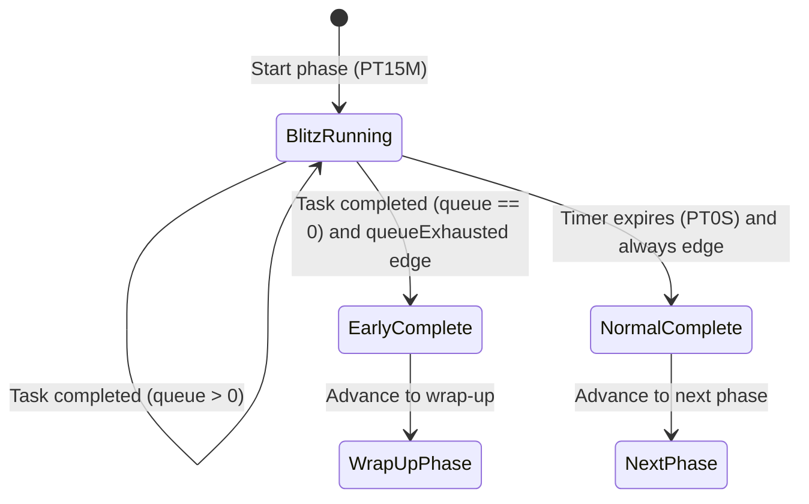
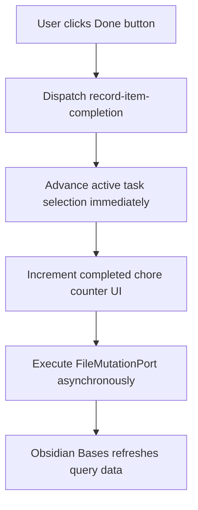

# Design

## Context

Chore blitz execution runs against a fixed countdown duration while users rapidly complete tasks.
Users need immediate check-off interactions, live completed task counts, and batch metric updates across all completed chore notes.
When the task queue empties before the countdown lapses, the phase must advance early to the next phase without waiting.
All state transformations must follow functional programming rules enforced by eslint.

## Goals / non-goals

**Goals:**
- Provide pure domain tracking of task completion state in `PhaseInstance.itemsTouched`.
- Support batch frontmatter write-backs across multiple completed chores via `PhaseLogTarget`.
- Enable deterministic early phase advancement upon queue exhaustion without race conditions.
- Deliver immediate queue check-off interactions without layout shift or interface freezing.
- Provide visual exhaustion feedback and in-app notice notifications on early completion.

**Non-goals:**
- Manual chore task re-ordering or custom drag-and-drop mechanics.
- Multiple concurrent task source queries in a single phase.
- Audio synthesis engines beyond the configured notification port sound hook.

## Decisions

### Decision 1: Distinguish viewed items from completed items in `ItemTouch`

`PhaseInstance.itemsTouched` currently records only initial task activation.
To track blitz progress and drive batch write-backs, `ItemTouch` will carry an explicit completion status.

```typescript
export type ItemTouchStatus = 'viewed' | 'completed'

export interface ItemTouch {
  readonly id: TaskQueueItemId
  readonly sourcePath: string
  readonly displayName: string
  readonly status: ItemTouchStatus
  readonly completedAt: Temporal.Instant | null
}
```

*Alternatives considered:*
- Track bare completed file paths in a separate array on `PhaseInstance`: Rejected because it duplicates item identity and separates activation history from completion records.
- Mutate `ItemTouch` records in place: Rejected because the repository enforces strict immutability.

### Decision 2: Batch log target resolution with `{ kind: 'completedItems' }`

`PhaseLogTargetSchema` will include `{ kind: 'completedItems' }` alongside `{ kind: 'activeItem' }`.
When a blitz phase finishes, the write-back hook resolves target file paths from all items in `PhaseInstance.itemsTouched` with `status: 'completed'`.

```typescript
export const PhaseLogTargetSchema = z.discriminatedUnion('kind', [
  z.object({ kind: z.literal('activeItem') }).readonly(),
  z.object({ kind: z.literal('completedItems') }).readonly(),
  z.object({ kind: z.literal('callback'), name: LogTargetResolverNameSchema }).readonly(),
]).readonly()

export function resolveTargetFilePaths(
  phase: PhaseNode,
  instance: PhaseInstance | null | undefined,
  activeFilePath: string | null,
  registry: LogTargetResolverRegistry,
): readonly string[] {
  if (phase.logTarget === null) {
    return []
  }
  if (phase.logTarget.kind === 'activeItem') {
    return activeFilePath !== null ? [activeFilePath] : []
  }
  if (phase.logTarget.kind === 'completedItems') {
    if (!instance) {
      return []
    }
    const completed = instance.itemsTouched
      .filter(touch => touch.status === 'completed')
      .map(touch => touch.sourcePath)
    return Array.from(new Set(completed))
  }
  const resolver = registry.resolve(phase.logTarget.name)
  const path = resolver === undefined ? null : resolver(phase)
  return path !== null ? [path] : []
}
```

*Alternatives considered:*
- Write back only to `activeFilePath`: Rejected because `activeFilePath` becomes `null` once the task queue is exhausted.
- Write back during each markDone click: Rejected because write-backs represent phase-level summary logging, and intermediate prompt/write steps disrupt rapid blitz flow.

### Decision 3: Deterministic early phase termination on queue exhaustion

`set-queue-exhausted` action will carry a stamped `now: Temporal.Instant`.
When `set-queue-exhausted` is dispatched with `exhausted: true` while `state.status === 'running'`, `engineReducer` checks if the current phase has an outgoing transition guarded by `condition: { kind: 'queueExhausted' }`.
If such an edge exists, `engineReducer` calls `completePhase`, which advances to the target phase and sets `endReason: 'completed'`.
If no such edge exists, the phase continues running its normal countdown.



*Race-condition mitigation:*
`EngineStore` serializes all dispatches via a promise queue (`pendingDispatch`).
`set-queue-exhausted` runs synchronously inside the pure reducer.
Subsequent ticks see the new phase identifier and do not trigger duplicate advances.

### Decision 4: Rapid UI markDone interactions and optimistic candidate selection

To avoid layout shifts and UI lag during rapid task completion:
1. The queue item Done button immediately dispatches `record-item-completion` for the active item.
2. The UI advances local selection immediately to the next remaining task in the queue items list.
3. The queue panel header increments the completed chore counter chip.
4. `actionExecutor.executeAction` applies the frontmatter mutation asynchronously through `FileMutationPort`.
5. When Obsidian Bases detects the frontmatter change and updates query results, the queue re-renders cleanly without scroll disruption.



### Decision 5: Configurable batch write-back execution and steel thread demo

Batch frontmatter logging requires flexibility across different routine types:
- Some users require programmatic post-phase handlers or confirmation selector modals.
- Others require automated, silent batch write-backs without modal interruptions during blitzes.

To accommodate this cleanly:
1. Define a configurable write-back hook contract supporting optional confirmation modes (`confirm: boolean`).
2. Implement a steel thread first: provide a concrete chore-blitz example routine that executes direct batch write-backs to increment completion counts on all finished chores.
3. Future releases can plug in interactive multi-item selection modals or programmatic filters without restructuring domain types.

### Decision 6: Transition timing, keyframe animations, and future transform hooks

Phase transitions following queue exhaustion support multiple progression modes:
- **Steel thread default**: Automatic transition with a short timer-based delay (e.g. 1200ms) that allows the user to perceive completion.
- **CSS keyframe hooks**: Attach CSS classes (e.g. `rf-blitz-exhausted`) to the timer panel root during early exit to enable keyframe animations that users or themes can style.
- **Future transform extension point**: The state machine architecture preserves clean boundaries for:
  - Animation completion event dispatching (`onAnimationEnd -> advancePhase`).
  - Interactive intermediate dialogs driven by phase input summaries before the next phase activates.

## Risks / trade-offs

- [Risk] Asynchronous Bases query updates could desynchronize active task path from store.
  Mitigation: `TimerView.applyAutoAdvance` validates `activeFilePath` against available candidate paths on every `onDataUpdated` signal.
- [Risk] Multiple rapid clicks on Done could queue duplicate mutations on the same item.
  Mitigation: Done button disables itself immediately upon click while local selection moves to the next task.
- [Risk] Routines with duration-less phases might evaluate queue exhaustion prematurely.
  Mitigation: Early advancement only executes when `status === 'running'` and an outgoing edge specifically requires `queueExhausted`.

## Migration plan

Existing routines without `queueExhausted` edges continue running without behavior changes.
Routines declaring `logTarget: { kind: 'completedItems' }` require schema validation support.
The schema addition is backward-compatible with existing `{ kind: 'activeItem' }` configurations.
